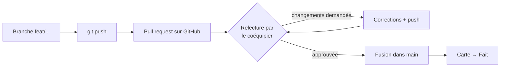

# Moodly : gestion de projet et travail en équipe

Comment l'équipe s'organise : le tableau des tâches, les règles Git, le circuit des pull requests
et la relecture de code entre coéquipiers.

---

## 1. Le tableau des tâches (Kanban)

Le suivi se fait dans **GitHub Projects**, sur le dépôt `kykiraza/Moodly-`, en 4 colonnes :
**À faire → En cours → En relecture → Fait**.

### Mettre en place le tableau (2 minutes)
1. Sur GitHub, ouvre le dépôt → onglet **Projects** → **New project** → modèle **Board**.
2. Nomme-le « Moodly » et renomme les colonnes : *À faire*, *En cours*, *En relecture*, *Fait*.
3. Pour chaque ligne du backlog ci-dessous, clique **+ Add item** et colle le titre.
4. Ajoute ton coéquipier dans **Settings → Manage access**.
5. Règle d'équipe : une carte passe en *En relecture* quand sa pull request est ouverte, et en
   *Fait* quand elle est fusionnée.

### Backlog

**Fait**

| Tâche | Partie | Terminé le |
| --- | --- | --- |
| Projet Strapi 5 (JavaScript, SQLite) | Back | 16/10 |
| Modèle de données : humeurs, équipes, raisons, entreprises | Back | 16/10 |
| Rôles salarié / manager et permissions | Back | 16/10 |
| Saisie du moral anonyme (empreinte HMAC, une réponse par jour) | Back | 16/10 |
| Statistiques manager (moyenne, tendance, répartition, raisons) | Back | 16/10 |
| Anonymat : seuil de 3 réponses, jours masqués, journée en cours cachée | Back | 16/10 |
| Purge RGPD automatique à 90 jours | Back | 16/10 |
| Connexion avec code entreprise et inscription | Back | 16/10 |
| Connexion Google / Apple / Microsoft (vérification des jetons) | Back | 16/10 |
| Données de démo (entreprise AG-0001, équipe de 12, 60 jours) | Back | 16/10 |
| App React Native (Expo) : les 6 écrans du prototype | Front | 16/10 |
| Session sécurisée (coffre-fort du téléphone), déconnexion auto | Front | 16/10 |
| Mode sombre, calendriers perso et équipe | Front | 16/10 |
| Lancement sur téléphone avec Expo Go | Front | 16/10 |
| Inscription : nom de l'entreprise affiché, conseils de mot de passe | Back + Front | 16/10 |
| Sauvegarde de la base (manuelle, chaque nuit, avant seed) | Back | 17/10 |
| Documentation : éthique, mise en œuvre, tutoriel, protocole | Docs | 17/10 |

**À faire**

| Tâche | Partie | Priorité |
| --- | --- | --- |
| Créer les identifiants Google et Microsoft, compiler l'app (EAS) | Front | Haute |
| Afficher les ressources d'aide (3114, médecine du travail) quand on répond « Pas bien » | Front | Haute |
| Activer `STRONG_PASSWORD=true` pour la soutenance et la production | Back | Haute |
| Préparer la soutenance : démo, vidéo, présentation | Équipe | Haute |
| Mettre le serveur en ligne en HTTPS (voir MISE-EN-OEUVRE.md) | Back | Moyenne |
| Copier les sauvegardes hors du serveur | Back | Moyenne |
| Choisir l'heure du rappel quotidien | Front | Basse |
| Publier sur l'App Store et le Play Store | Front | Basse |

## 2. Règles Git

| Règle | Exemple |
| --- | --- |
| Une branche par sujet, créée depuis `main` | `git switch -c feat/ressources-aide` |
| Petits commits, message en français avec un préfixe | `feat(back): …`, `fix(native): …`, `docs: …` |
| On ne travaille jamais directement sur `main` | `main` = la version qui marche |
| Avant de proposer sa branche : récupérer `main` | `git pull origin main` |
| Jamais de secret sur Git | `.env`, `.env.local`, la base et `backups/` sont ignorés |

Préfixes : `feat` (nouveauté), `fix` (correction), `docs` (documentation), `chore` (outillage).

## 3. Le circuit d'une pull request



1. `git push -u origin <ma-branche>`, puis GitHub affiche un lien **« Compare & pull request »**.
2. Remplis la description avec le modèle ci-dessous et demande la relecture du coéquipier.
3. Le coéquipier relit (§4) : il **approuve** ou **demande des changements**.
4. Une fois approuvée, on fusionne. **Personne ne fusionne sa propre PR sans relecture.**

### Modèle de description de pull request
```markdown
## Quoi
Ce que fait la branche, en 2-3 lignes.

## Pourquoi
Le besoin (carte du tableau, retour utilisateur…).

## Comment tester
1. npm run develop (back) et npm run web (app)
2. Étapes pour voir le changement

## Points d'attention
Ce qui mérite un regard particulier (sécurité, anonymat…).
```

## 4. Relire le code d'un coéquipier : la grille

**Comment faire un retour constructif :**
- **Commencer par ce qui est réussi.** Être précis : « bonne idée de masquer la journée en cours ».
- **Parler du code, pas de la personne.** Dire « cette fonction pourrait… » plutôt que « tu as mal fait ».
- **Expliquer le pourquoi et proposer une solution** : « si X est vide, ça plante ; on pourrait
  vérifier avant ».
- **Distinguer le bloquant du conseil**, en préfixant `[bloquant]`, `[suggestion]` ou `[question]`.

**Ce qu'on vérifie :**
- [ ] Ça marche : j'ai lancé la branche et suivi « Comment tester ».
- [ ] **Anonymat respecté** : pas de lien humeur ↔ utilisateur, le manager ne voit que des agrégats.
- [ ] Sécurité : nouvelle route ajoutée dans `src/bootstrap/permissions.js`, données de l'utilisateur vérifiées.
- [ ] Aucun secret ni mot de passe dans le code.
- [ ] Le code est lisible et commenté en français, comme le reste du projet.
- [ ] La documentation est à jour (README, `requests.http`).

## 5. Réunions d'équipe
Un point court chaque semaine, consigné avec le modèle
[COMPTE-RENDU-MODELE.md](COMPTE-RENDU-MODELE.md) (ce qui est fait, les blocages, les décisions).
