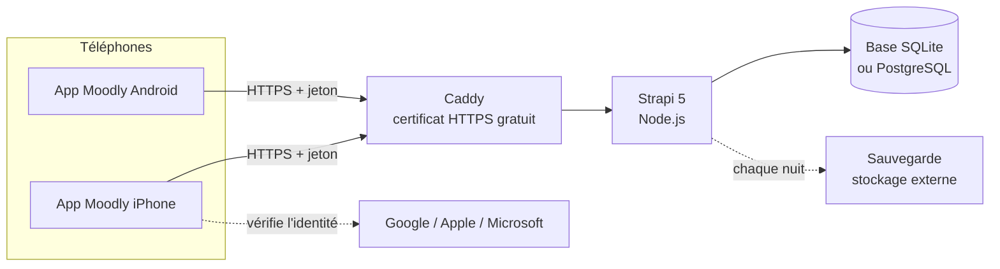

# Moodly : mise en œuvre réaliste

Comment passer du prototype (qui tourne sur un Mac) à un vrai déploiement dans une entreprise
cliente : hébergement, publication de l'app, sauvegardes, coûts et calendrier.

> Les prix sont des **ordres de grandeur** (octobre 2026), à vérifier au moment du devis.

---

## 1. Où on en est

| Élément | Prototype actuel | En production |
| --- | --- | --- |
| Serveur (API Strapi) | Sur le Mac du développeur | Serveur loué en France / UE, allumé 24h/24 |
| Base de données | SQLite (un fichier) | SQLite sur le serveur (suffit pour quelques centaines de salariés) ou PostgreSQL au-delà |
| Adresse | `http://localhost:1337` | `https://api.moodly.fr` (HTTPS obligatoire) |
| App | Navigateur ou Expo Go | App installée depuis l'App Store / le Play Store |
| Sauvegardes | `npm run backup` + chaque nuit à 2h30 | Idem, **copiées hors du serveur** chaque nuit |

## 2. Architecture cible

## 3. Étapes de déploiement

### Serveur (1 journée)
1. Louer un petit serveur virtuel en France (OVHcloud, Scaleway…) : 2 Go de RAM suffisent.
2. Installer Node.js 22 et récupérer le code : `git clone`, puis `npm ci` dans `Moodly/moodly-back`.
3. Créer le `.env` avec `npm run setup` (génère les clés secrètes), puis régler :
   - `STRONG_PASSWORD=true` (mots de passe solides obligatoires) ;
   - `BACKUP_DIR` vers un dossier synchronisé avec un stockage externe ;
   - les identifiants Google / Apple / Microsoft (voir `Moodly/moodly-native/GUIDE-CONNEXION-SOCIALE.md`).
4. Construire puis lancer en mode production : `npm run build` puis `npm run start`, gardé allumé
   par un gestionnaire de services (systemd ou pm2), qui le relance aussi après un redémarrage.
5. Mettre **Caddy** devant : il obtient et renouvelle tout seul le certificat HTTPS (Let's Encrypt).
6. Créer l'entreprise cliente, ses équipes et ses managers dans l'administration Strapi (`/admin`).

### App (2 à 3 jours, surtout de l'attente de validation)
1. Mettre l'adresse de production : `EXPO_PUBLIC_API_URL=https://api.moodly.fr/api`.
2. **Retirer les autorisations « HTTP non sécurisé »** de `app.config.js` (utiles seulement en local).
3. Compiler avec EAS Build : `eas build --profile production --platform all`.
4. Publier : `eas submit` vers l'App Store (validation Apple : 1 à 3 jours) et le Play Store.

### Sauvegardes (déjà prêtes)
- `npm run backup` : copie immédiate. `npm run restore -- <fichier>` : restauration (serveur arrêté).
- Une copie automatique chaque nuit à 2h30, et avant chaque `npm run seed`.
- Les 14 dernières sont gardées (`BACKUP_KEEP`).
- **À faire en production** : copier le dossier `BACKUP_DIR` hors du serveur (stockage objet
  chiffré). Une sauvegarde sur la même machine ne protège pas d'une panne de la machine.
- **Tester une restauration une fois par mois** : une sauvegarde jamais testée ne vaut rien.

## 4. Coûts estimés

| Poste | Coût | Fréquence |
| --- | --- | --- |
| Serveur virtuel (France) | 5 à 15 € | par mois |
| Nom de domaine | ~10 € | par an |
| Certificat HTTPS (Let's Encrypt) | 0 € | — |
| Stockage des sauvegardes | < 1 € | par mois |
| Apple Developer Program (App Store + connexion Apple) | 99 $ | par an |
| Google Play Console | 25 $ | une seule fois |
| EAS Build (compilation dans le cloud) | 0 € (offre gratuite, quelques builds par mois) | — |
| Google / Microsoft (connexion) | 0 € | — |
| **Total de départ** | **≈ 250 € la 1re année**, puis ≈ 200 €/an | |

Le budget le plus important reste **humain** : lancement auprès des équipes, formation des
managers, maintenance.

## 5. Calendrier de déploiement conseillé

| Semaine | Étape | Objectif mesurable |
| --- | --- | --- |
| S1 | Mise en ligne du serveur et des apps | API joignable en HTTPS, apps validées par les stores |
| S2 | **Pilote** avec une équipe volontaire (8 à 15 personnes) | Présentation de l'anonymat, charte d'usage signée par le manager |
| S2 à S5 | Pilote en conditions réelles | Taux de participation > 50 %, retours qualitatifs des salariés |
| S6 | Bilan du pilote avec l'équipe et les RH | Décision : on corrige, on étend ou on arrête |
| S7 et après | Extension par vagues d'équipes | Participation stable, managers formés à la lecture des chiffres |

## 6. Risques du déploiement

| Risque | Parade |
| --- | --- |
| Les salariés ne font pas confiance à l'anonymat | Démonstration au lancement (le manager montre son écran : pas de noms), charte |
| Participation qui s'effondre après 2 semaines | Rappel quotidien, et **montrer que les retours servent** (actions visibles du manager) |
| Panne du serveur | Relance automatique (systemd / pm2), sauvegardes nocturnes externalisées, restauration testée |
| Équipes trop petites (< 3 personnes) | Regrouper les petites équipes pour les statistiques |
| Données de santé au sens strict | Moodly reste sur le « moral » sans diagnostic ; AIPD faite avec le DPO du client |

Voir aussi : [ETHIQUE-VIE-PRIVEE-RISQUES.md](ETHIQUE-VIE-PRIVEE-RISQUES.md).
