# Tutoriel Moodly : partager son moral en 30 secondes

Ce guide montre, écran par écran, comment utiliser Moodly en tant que **salarié** puis en tant que
**manager**. 🎬 Une vidéo de démonstration (≈ 1 min 30) est jointe à la pull request « docs-competences » sur GitHub.

> **Ce qu'il faut retenir :** tes réponses sont **anonymes**. Ton manager voit seulement la
> moyenne de l'équipe, jamais ta réponse. Ton petit message reste sur ton téléphone.

---

## Partie 1 : Je suis salarié

### Étape 1 : Découvrir l'app
Au premier lancement, Moodly se présente en 3 écrans. Touche **Continuer**, ou **Passer** pour
aller directement à la suite.

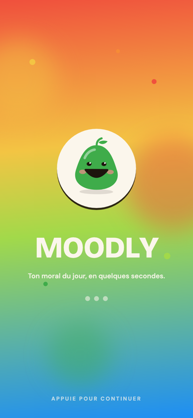 

### Étape 2 : Créer mon compte
Touche **Créer un compte**, puis remplis :
1. **Le code de ton entreprise** (ex. `AG-0001`), donné par ton entreprise. Le nom de
   l'entreprise s'affiche en vert : vérifie que c'est la bonne.
2. Ton nom (facultatif), ton email et un mot de passe. Les conseils se cochent en vert quand ton
   mot de passe est solide.

Tu peux aussi t'inscrire avec **Google**, **Apple** ou **Microsoft**.

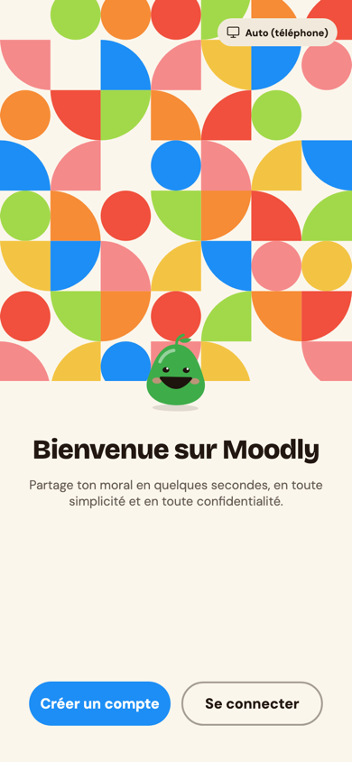 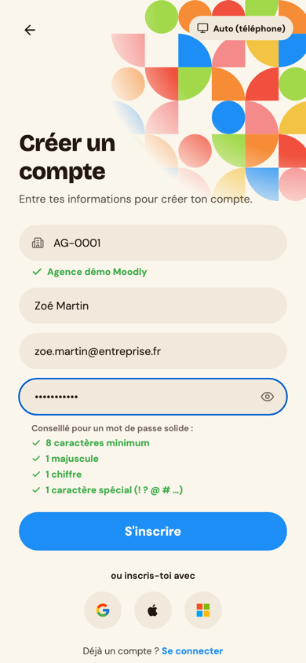

### Étape 3 : Me connecter
Les fois suivantes, touche **Se connecter** et entre le code de ton entreprise, ton email et ton
mot de passe. Tu restes connecté 7 jours.

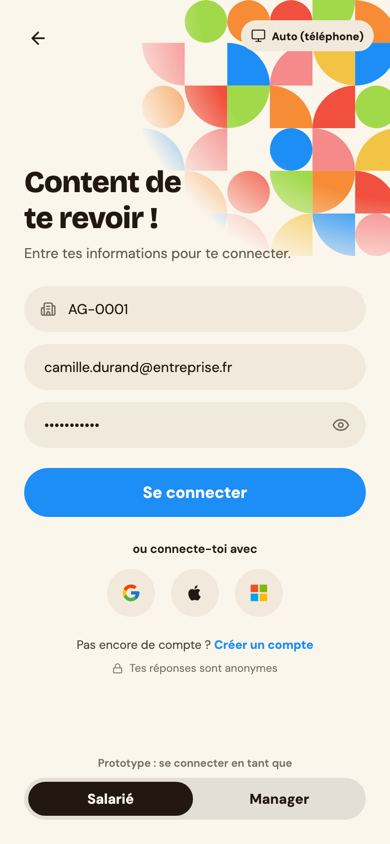

### Étape 4 : Dire comment je me sens (une fois par jour)
1. **Mon humeur** : touche une des 5 mascottes (de « Pas bien » à « Super ») ou fais glisser le
   curseur, puis **Suivant**.
2. **Pourquoi ?** (facultatif) : choisis jusqu'à 3 raisons (charge de travail, ambiance…).
3. **Un petit mot** (facultatif) : il reste **uniquement sur ton téléphone**, personne d'autre
   ne le lit.
4. Touche **Envoyer**. C'est fait jusqu'à demain !

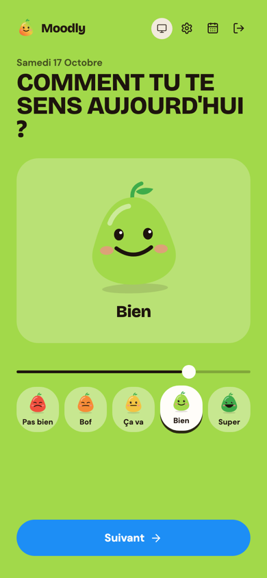 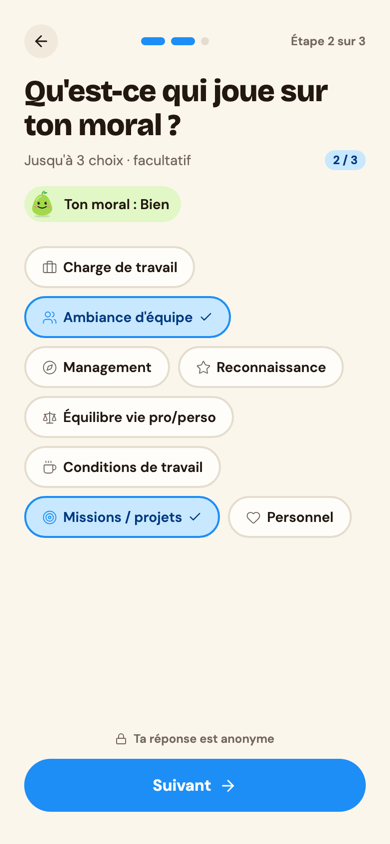 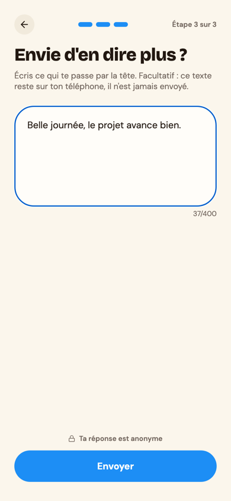 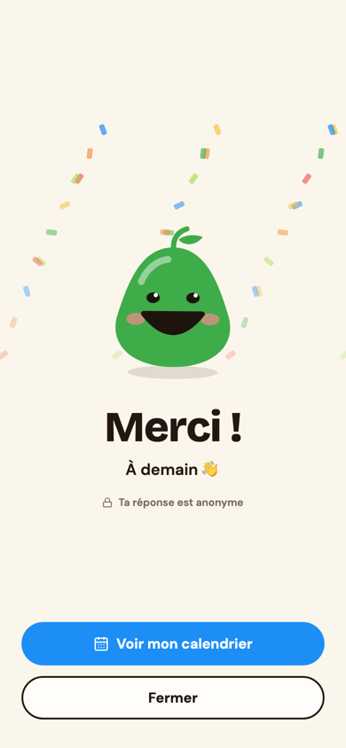

> Un rappel arrive chaque jour à 10 h. Tu peux le couper dans les **Paramètres** (icône ⚙️).

### Étape 5 : Revoir mon historique
Touche l'icône **calendrier** en haut. Chaque jour prend la couleur de ton humeur. Touche un jour
pour revoir ton humeur, tes raisons et ton message. Cet historique est **stocké seulement sur
ton téléphone**.

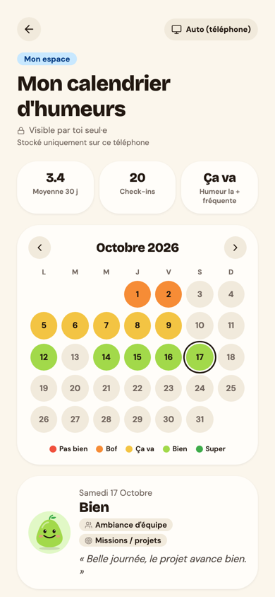

### Étape 6 : Régler l'app
Dans les **Paramètres** (icône ⚙️) : ton compte, ton entreprise, le thème clair ou sombre, le
rappel quotidien et la déconnexion.

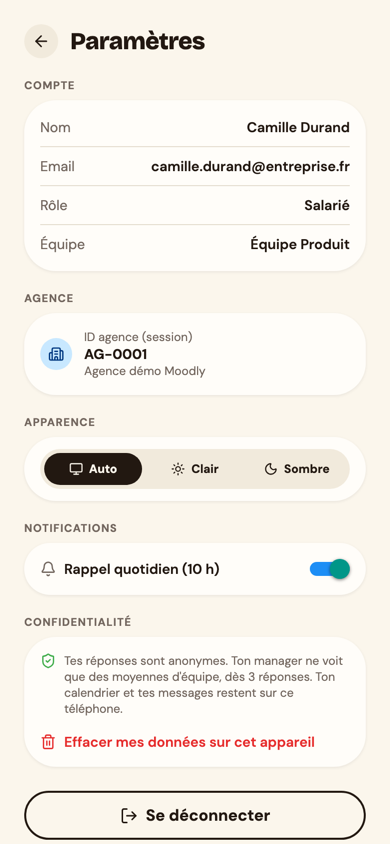

---

## Partie 2 : Je suis manager

### Étape 1 : La météo de mon équipe
En te connectant avec ton compte manager, tu arrives sur le **tableau de bord** de ton équipe :
- **La météo** : le moral moyen sur la période (7 jours, 30 jours ou trimestre) et sa tendance ;
- **La participation** : combien de personnes répondent ;
- **Le moral jour par jour**, sous forme de courbe ;
- **La répartition** des humeurs et **les raisons les plus citées** ;
- **Le conseil Moodly** : une piste d'action selon ce qui ressort.

 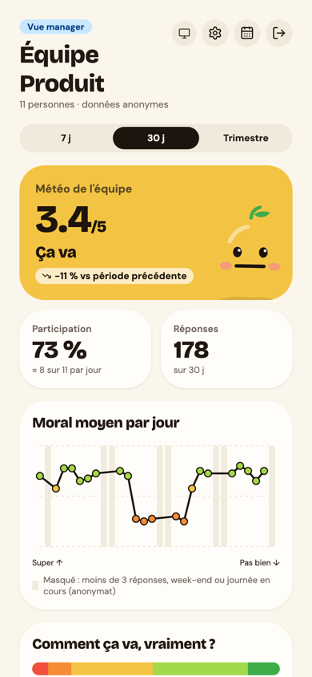

> **Pourquoi certains jours sont masqués ?** Un jour avec moins de 3 réponses, le week-end ou la
> journée en cours ne sont jamais affichés : sinon on pourrait deviner la réponse d'une personne.

### Étape 2 : Le calendrier d'équipe
Touche l'icône **calendrier** : chaque jour a la couleur du moral moyen de l'équipe. Touche un
jour pour voir sa moyenne et le nombre de réponses.

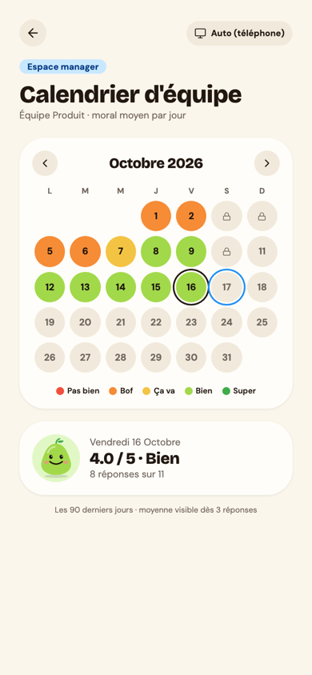

### Bonnes pratiques pour le manager
- **Regarde les tendances**, pas un jour isolé.
- **Parles-en avec l'équipe** : Moodly ouvre la discussion, il ne la remplace pas.
- **Ne cherche jamais à savoir qui a répondu quoi** : l'outil est conçu pour que ce soit
  impossible, et c'est ce qui donne confiance aux salariés.

---

## Questions fréquentes

| Question | Réponse |
| --- | --- |
| Mon manager peut-il voir ma réponse ? | **Non.** Il ne voit que des moyennes, à partir de 3 réponses. |
| Je peux répondre plusieurs fois par jour ? | Non, une seule réponse par jour. |
| J'ai changé de téléphone, où est mon historique ? | L'historique est sur l'ancien téléphone : il n'est volontairement pas envoyé au serveur. |
| J'ai oublié le code de mon entreprise | Demande-le à ton manager ou aux RH. |
| Combien de temps mes réponses sont gardées ? | 90 jours, puis elles sont supprimées automatiquement. |
